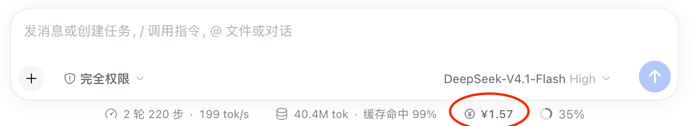

<p align="center"></p>

# dsh-token-balance

[English](#english) | [中文](#中文)



> A live DeepSeek account-balance chip in the DeepSeek Harness (DSH) composer dock.
> 在 DeepSeek Harness 输入框下方实时显示 DeepSeek 账户余额。

---

## English

### What it does

`dsh-token-balance` adds a small balance chip to the composer dock — the status row below the message box, next to the context-usage meter.

- Shows the **total credit** (recharge balance + bonus balance) and keeps it current.
- Hover for the breakdown: total, recharge, bonus, last update time, and the refresh hint.
- Click the chip to refresh immediately.
- Refreshes automatically on mount, every 30 seconds, when the tab becomes visible or focused, and when the current turn finishes.
- Uses the signed-in DeepSeek account through the Host `account/getBalance` Remote. It never reads, stores, or sends an API key.
- Signed out → "Not signed in"; read failure → "Balance unavailable" with up to three automatic retries.
- Follows the host theme tokens and the active UI language (English and Chinese dictionaries included).

<!-- Screenshot: add a real screenshot of the chip below the composer here. -->

### Install

The npm release is not published yet. Install from the public Git repository:

```sh
dsh plugin --profile web add github:feiniao1933/dsh-token-balance
```

Or pin a commit (recommended for reproducible installs):

```sh
dsh plugin --profile web add git+https://github.com/feiniao1933/dsh-token-balance.git#<commit>
```

Replace `web` with your profile name. Once the npm package is published, `dsh plugin --profile web add dsh-token-balance` works too.

### Configuration

Override the row in your profile's `cordis.patch.yml`:

```yaml
- id: token-balance
  config:
    refreshIntervalMs: 30000 # 5000–3600000
```

### How it works

The Client half reads `ctx.get('remote.account').getBalance(...)` and renders the chip through the `conversation.composer.dock` slot. The Host half only publishes the refresh interval through `webserver/index-inject`. There is no Host HTTP route and no extra dependency.

Amounts are formatted with the same rules as the account settings page: truncated to cents, positive sub-cent amounts shown as `<¥0.01`, and wallets joined with ` + `. The chip displays the sum of recharge and bonus wallets; the tooltip keeps them separate.

### Compatibility

Tested with DSH `0.2.2-rc.1` on macOS. The bundle declares `dsh.bundle.patch`, so it installs with `dsh plugin add`.

### License

MIT. See [LICENSE](LICENSE).

---

## 中文

### 功能

`dsh-token-balance` 在输入框下方的状态行（和上下文占用百分比同一行）加一个余额胶囊。

- 显示 **账户可用总额**（充值余额 + 赠送余额），并持续刷新。
- 悬停显示明细：总额、充值余额、赠送余额、最后更新时间，以及刷新提示。
- 点击胶囊立即刷新。
- 自动刷新：挂载时、每 30 秒、标签页重新可见/获得焦点、当前会话一轮结束时。
- 数据来自已登录 DeepSeek 账户的 Host `account/getBalance` Remote，不读取、不保存、不外发任何 API Key。
- 未登录显示“未登录”；读取失败显示“余额不可用”，并自动重试最多 3 次。
- 使用宿主主题变量，跟随明暗主题；内置中英文文案。

### 安装

npm 版本尚未发布。先从公开仓库安装：

```sh
dsh plugin --profile web add github:feiniao1933/dsh-token-balance
```

或固定提交（推荐，安装结果可复现）：

```sh
dsh plugin --profile web add git+https://github.com/feiniao1933/dsh-token-balance.git#<commit>
```

把 `web` 换成你的 profile 名称；按宿主要求重启或刷新页面。npm 包发布后也可以用 `dsh plugin --profile web add dsh-token-balance`。

### 配置

在 profile 的 `cordis.patch.yml` 中覆盖该行：

```yaml
- id: token-balance
  config:
    refreshIntervalMs: 30000 # 5000–3600000
```

### 实现

Client 半通过 `ctx.get('remote.account').getBalance(...)` 读取余额，并注册到 `conversation.composer.dock`；Host 半只通过 `webserver/index-inject` 下发刷新间隔。没有额外的 Host HTTP 路由，也没有运行时依赖。

金额格式与账户设置页一致：截断到分，正的不足一分显示为 `<¥0.01`，多币种用 ` + ` 连接。胶囊显示充值 + 赠送的合计，悬停时分别列出。

### 兼容性

在 macOS 的 DSH `0.2.2-rc.1` 上测试通过。包内声明了 `dsh.bundle.patch`，可用 `dsh plugin add` 安装。

### 许可证

MIT，见 [LICENSE](LICENSE)。
